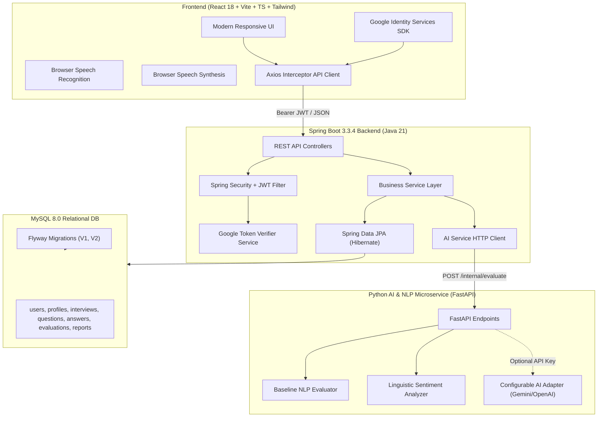
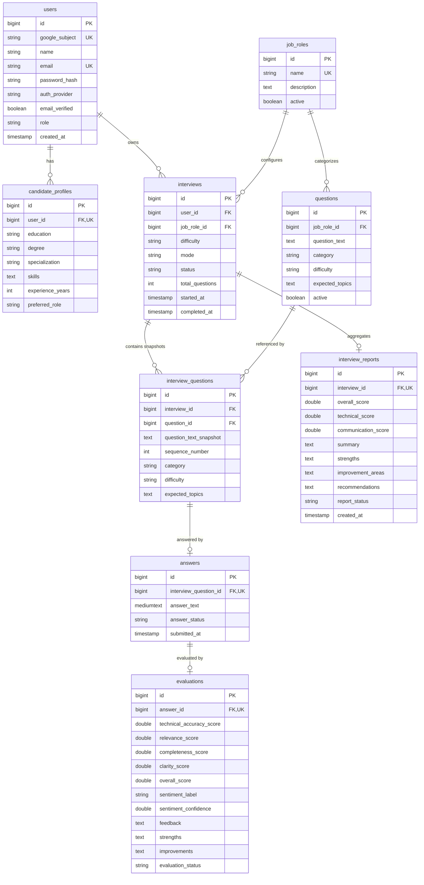

# Automated Candidate Interview Sentiment Analytics and Technical Competency Evaluation Platform

[](https://www.oracle.com/java/)
[](https://spring.io/projects/spring-boot)
[](https://react.dev/)
[](https://www.typescriptlang.org/)
[](https://www.python.org/)
[](https://fastapi.tiangolo.com/)
[](https://www.mysql.com/)
[](LICENSE)

An enterprise-grade, real-time mock technical interview platform built for Computer Science Engineering students and job seekers. The system provides role-specific technical question sequencing, multimodal input (browser voice speech recognition and text typing), speech synthesis for auditory question delivery, and real-time AI/NLP evaluation across a calibrated 4-dimensional scoring rubric.

---

## 1. Problem Statement
Technical interview preparation often suffers from three major challenges:
1. **Subjective or Uncalibrated Feedback**: Candidates rarely receive granular, rubric-based feedback on technical accuracy versus structural communication clarity.
2. **Absence of Multimodal Voice Experience**: Most online practice platforms are purely code-editor or multiple-choice based, failing to prepare candidates for verbal technical articulation required in live interviews.
3. **Data Ephemerality**: Practice sessions on ad-hoc platforms do not track historical performance trends across domains or preserve question snapshots when question banks evolve.

## 2. Project Objectives
- Provide realistic mock interviews across 6 key technical domains: **Java Developer, Python Developer, Full Stack Developer, Frontend Developer, Backend Developer, and SQL/Database Engineer**.
- Support flexible interaction modes: **Voice Mode** (speech synthesis question read-aloud + live editable speech-to-text recognition) and **Text Mode** (syntax-focused structured writing).
- Evaluate candidate answers against a weighted rubric:
  - **Technical Accuracy (40%)**
  - **Relevance (25%)**
  - **Completeness (20%)**
  - **Communication Clarity (15%)**
- Provide linguistic sentiment indicators (confidence, filler word count, hesitation patterns) with explicit separation from technical competence.
- Persist users, profiles, interview sessions, question snapshots, answers, evaluations, and reports reliably in MySQL using Flyway migrations.

---

## 3. System Architecture



---

## 4. Database Schema (ER Diagram)



---

## 5. Technology Stack Summary

| Layer | Technologies |
|---|---|
| **Frontend** | React 18, Vite, TypeScript 5.6, Tailwind CSS 3.4, React Router 6, Axios, Lucide React, Recharts |
| **Voice & Speech** | Web Speech API (`SpeechRecognition` for input, `SpeechSynthesis` for question read-aloud) |
| **Backend** | Java 21 LTS, Spring Boot 3.3.4, Spring Web, Spring Data JPA, Spring Security, Flyway, JJWT 0.12.6, Google API Client 2.7.0 |
| **Database** | MySQL 8.x, Hibernate 6, HikariCP connection pool |
| **AI & NLP** | Python 3.11+, FastAPI, Pydantic v2, Uvicorn, custom NLP baseline evaluator + optional Gemini / OpenAI adapter |
| **DevOps** | Docker, Docker Compose, Multi-stage Dockerfiles, Nginx |

---

## 6. Project Directory Structure

```text
automated-interview-platform/
├── backend/
│   ├── src/
│   │   ├── main/
│   │   │   ├── java/com/interview/platform/
│   │   │   │   ├── PlatformApplication.java
│   │   │   │   ├── client/           # RestTemplate AI microservice client with fallback
│   │   │   │   ├── config/           # SecurityConfig, CorsConfig
│   │   │   │   ├── controller/       # Auth, Profile, JobRole, Interview, Report REST APIs
│   │   │   │   ├── dto/              # Request/Response data transfer objects
│   │   │   │   ├── entity/           # JPA Entities (User, Interview, Answer, Report...)
│   │   │   │   ├── exception/        # GlobalExceptionHandler and custom exceptions
│   │   │   │   ├── repository/       # Spring Data JPA Repositories
│   │   │   │   ├── security/         # JwtService, GoogleTokenVerifierService, UserPrincipal
│   │   │   │   └── service/          # Core transaction services
│   │   │   └── resources/
│   │   │       ├── application.yml   # Production & local environment config
│   │   │       └── db/migration/     # V1__init_schema.sql, V2__seed_data.sql
│   │   └── test/                     # Unit and integration test suite
│   ├── pom.xml
│   ├── .env.example
│   └── Dockerfile
├── ai-service/
│   ├── app/
│   │   ├── config.py                 # Provider and port configuration
│   │   ├── evaluator.py              # Baseline NLP and External LLM scoring engine
│   │   ├── main.py                   # FastAPI REST microservice
│   │   ├── schemas.py                # Pydantic request/response schemas
│   │   └── sentiment.py              # Linguistic cadence and filler word analyzer
│   ├── tests/
│   │   └── test_evaluator.py         # Pytest test suite
│   ├── requirements.txt
│   ├── .env.example
│   └── Dockerfile
├── frontend/
│   ├── src/
│   │   ├── api/                      # Axios client with JWT interceptor
│   │   ├── components/               # Navbar, Footer, ProtectedRoute, GoogleSignInButton
│   │   ├── context/                  # AuthContext (login, register, Google OAuth)
│   │   ├── pages/                    # Landing, Login, Register, Dashboard, Profile, Setup, Room, Report, History
│   │   ├── types/                    # TypeScript interfaces for all entities
│   │   ├── App.tsx                   # Main router
│   │   ├── index.css                 # Tailwind directives
│   │   └── main.tsx                  # Vite React root
│   ├── package.json
│   ├── vite.config.ts
│   ├── tailwind.config.js
│   ├── nginx.conf
│   ├── .env.example
│   └── Dockerfile
├── docker-compose.yml
├── .env.example
├── .gitignore
└── README.md
```

---

## 7. API Specification

### Authentication (`/api/v1/auth`)
- `POST /api/v1/auth/google`: Verifies Google ID token, extracts `sub`, returns app JWT.
- `POST /api/v1/auth/register`: Register with name, email, password.
- `POST /api/v1/auth/login`: Authenticate with email and password.
- `GET /api/v1/auth/me`: Retrieve current authenticated candidate details.
- `POST /api/v1/auth/logout`: Revoke/terminate session.

### Candidate Profile (`/api/v1/profile`)
- `GET /api/v1/profile`: Retrieve candidate profile (education, skills, experience).
- `PUT /api/v1/profile`: Update candidate academic and domain skills profile.

### Job Roles & Question Bank (`/api/v1/job-roles`)
- `GET /api/v1/job-roles`: List all active technical domains.
- `GET /api/v1/job-roles/{id}`: Get specific job role details.
- `GET /api/v1/job-roles/{id}/questions`: Get questions list for job role.

### Interviews & Evaluation (`/api/v1/interviews`)
- `POST /api/v1/interviews`: Start new interview session (role, difficulty, mode: TEXT/VOICE, question count).
- `GET /api/v1/interviews`: List candidate's interviews.
- `GET /api/v1/interviews/dashboard`: Get aggregate statistics (completed count, average score, recent sessions).
- `GET /api/v1/interviews/{id}`: Get interview status, progress, and questions.
- `GET /api/v1/interviews/{id}/questions`: Retrieve questions for session.
- `POST /api/v1/interviews/{id}/answers`: Submit answer for question. Invokes AI evaluator, persists answer and evaluation.
- `POST /api/v1/interviews/{id}/complete`: Finalize interview, compute overall metrics, and save permanent report.
- `GET /api/v1/interviews/{id}/report`: Retrieve stored evaluation report.
- `GET /api/v1/reports/history`: Candidate's historical reports timeline.

### Sample Request & Response

#### Submit Answer (`POST /api/v1/interviews/1/answers`):
```json
{
  "interviewQuestionId": 1,
  "answerText": "ConcurrentHashMap achieves thread safety through bucket-level locking and CAS operations without locking the entire table."
}
```

#### Evaluation Response:
```json
{
  "success": true,
  "message": "Answer evaluated and saved successfully",
  "data": {
    "id": 1,
    "interviewQuestionId": 1,
    "answerText": "ConcurrentHashMap achieves thread safety...",
    "answerStatus": "SUBMITTED",
    "evaluation": {
      "id": 1,
      "technicalAccuracyScore": 68.5,
      "relevanceScore": 85.0,
      "completenessScore": 45.0,
      "clarityScore": 85.0,
      "overallScore": 67.4,
      "sentimentLabel": "POSITIVE",
      "sentimentConfidence": 0.88,
      "feedback": "Baseline evaluation completed. Answer scored 67.4/100 based on keyword coverage and structural depth.",
      "strengths": "Demonstrated core competence by accurately discussing: bucket level locking, CAS",
      "improvements": "Incorporate key architectural and conceptual aspects: segments, concurrency",
      "evaluationStatus": "COMPLETED"
    }
  }
}
```

---

## 8. Google OAuth Setup Guide

1. Navigate to the **[Google Cloud Console](https://console.cloud.google.com/)**.
2. Create a new project or select an existing project.
3. Open **APIs & Services** > **OAuth consent screen**:
   - User Type: **External**.
   - App name: **SmartInterview AI Platform**.
   - User support email: Select your email.
   - Developer contact email: Enter your email.
   - Scopes: Add `.../auth/userinfo.email` and `.../auth/userinfo.profile`.
4. Open **APIs & Services** > **Credentials**:
   - Click **Create Credentials** > **OAuth client ID**.
   - Application type: **Web application**.
   - Name: `Interview Platform Web Client`.
   - **Authorized JavaScript origins**:
     - `http://localhost:5173`
     - `http://localhost:3000`
     - Your production frontend domain (e.g. `https://your-domain.vercel.app`).
5. Copy your generated **Client ID** (format: `1234567890-abcdefg.apps.googleusercontent.com`).
6. Set this value in your environment:
   - Root `.env`: `GOOGLE_CLIENT_ID=your_google_web_client_id` and `VITE_GOOGLE_CLIENT_ID=your_google_web_client_id`
   - Frontend `frontend/.env`: `VITE_GOOGLE_CLIENT_ID=your_google_web_client_id`
   - Backend `backend/.env`: `GOOGLE_CLIENT_ID=your_google_web_client_id`

> **Note on Security**: Never expose a Google client secret on the frontend. The Spring Boot backend independently verifies token signatures using Google's public key infrastructure.

---

## 9. AI Provider Setup (Baseline vs External)

The application supports dual evaluation modes:

### 1. Default Baseline Mode (Zero-cost, 100% Offline)
- `AI_PROVIDER=baseline`
- No external API key required.
- Uses algorithmic NLP concept matching, keyword coverage, length/completeness ratio, and filler word detection.
- All scores are labeled with `evaluationMethod: "BASELINE"` for transparent auditability.

### 2. External LLM Mode (Optional Gemini / OpenAI)
- To enable Gemini:
  ```dotenv
  AI_PROVIDER=gemini
  AI_API_KEY=AIzaSy...
  AI_MODEL=gemini-1.5-flash
  ```
- To enable OpenAI:
  ```dotenv
  AI_PROVIDER=openai
  AI_API_KEY=sk-...
  AI_MODEL=gpt-4o-mini
  ```
- If an external call times out or encounters network failure, the system **automatically falls back** to the deterministic baseline evaluator. Candidate answers are never lost.

---

## 10. How to Run the Application

### Option A: Complete Docker Compose (Recommended)

Make sure Docker is running on your machine:
```bash
# Clone the repository
git clone <repo-url>
cd interview

# Create .env from template
cp .env.example .env

# Build and start all 4 containers (MySQL, AI-Service, Backend, Frontend)
docker compose up --build
```
- Frontend UI: `http://localhost:5173`
- Backend API & Actuator: `http://localhost:8080/actuator/health`
- AI Microservice Health: `http://localhost:8000/health`
- MySQL: `localhost:3306`

---

### Option B: Local Development (Windows / macOS / Linux)

#### 1. Prerequisites Check
Verify your local toolchain:
```powershell
java -version    # Requires Java 21+
mvn -v           # Requires Maven 3.8+
python --version # Requires Python 3.11+
node -v          # Requires Node 18+
npm -v           # Requires npm 9+
```

#### 2. Start MySQL Database
Ensure MySQL 8.x is running locally on port 3306.
Create the database:
```sql
CREATE DATABASE IF NOT EXISTS interview_platform CHARACTER SET utf8mb4 COLLATE utf8mb4_unicode_ci;
```

#### 3. Start Python AI Microservice
```powershell
cd ai-service
python -m venv venv
.\venv\Scripts\Activate.ps1
pip install -r requirements.txt
$env:PYTHONPATH="."
uvicorn app.main:app --host 0.0.0.0 --port 8000 --reload
```
Verify: Open `http://localhost:8000/health` in your browser.

#### 4. Start Java Spring Boot Backend
```powershell
cd backend
# Database migrations run automatically via Flyway on startup
mvn spring-boot:run
```
Verify: Open `http://localhost:8080/actuator/health` (should return `{"status":"UP"}`).

#### 5. Start React Frontend
```powershell
cd frontend
npm install
npm run dev
```
Open `http://localhost:5173` in your browser.

---

## 11. Automated Test Commands

### 1. Spring Boot Backend Tests (JUnit 5 + Mockito)
```powershell
cd backend
mvn test
```
Tests cover:
- Candidate registration with BCrypt hashing.
- Duplicate email conflict rejection.
- Google ID token verification handling.
- Ownership protection (User B cannot access User A's interview).
- Duplicate answer submission prevention.
- Score calculations and Flyway migrations.

### 2. Python AI Service Tests (Pytest)
```powershell
cd ai-service
$env:PYTHONPATH="."
.\venv\Scripts\python.exe -m pytest tests
```
Tests cover:
- `/health` endpoint verification.
- High-quality technical answer evaluation.
- Short / partial answer handling.
- Sentiment analysis (filler word detection, hesitation patterns, clarity level).
- Input validation (empty question or empty answer rejection).

### 3. Frontend Production Build & TypeScript Verification
```powershell
cd frontend
npm run build
```
Executes `tsc` type-checking and `vite build` production minification.

---

## 12. Deployment Guide

### Free-Tier Friendly Deployment Options:
1. **Frontend**: Deploy on **Vercel** or **Cloudflare Pages** (Free static hosting).
   - Set build command: `npm run build`
   - Output directory: `dist`
   - Environment variables: `VITE_API_BASE_URL=https://your-backend.up.railway.app/api/v1`
2. **Backend**: Deploy on **Railway**, **Render**, or **Fly.io**.
   - Docker build from `backend/Dockerfile`.
   - Set environment variables (`DB_HOST`, `DB_PASSWORD`, `JWT_SECRET`, `AI_SERVICE_URL`).
3. **AI Service**: Deploy on **Render** (Free Web Service) or **Fly.io**.
   - Docker build from `ai-service/Dockerfile`.
4. **Database**: Use **Aiven for MySQL** (Free tier available) or **Railway MySQL**.

---

## 13. Security and Ethical AI Statement

### Security Controls
- **Stateless JWT**: Short-lived tokens with cryptographically signed HMAC-SHA256 signatures.
- **BCrypt Hashing**: 10-round salted password hashing for password-based accounts.
- **Resource Ownership Enforced**: Every interview, question, answer, and report endpoint verifies the authenticated `UserPrincipal.getId()`. Attempts to access another user's interview return `403 FORBIDDEN`.
- **CORS Control**: Restricted to authorized frontend origins.
- **Zero Raw Audio Storage**: Browser Speech Recognition transcribes speech directly on the client. Raw audio is never transmitted or stored on the server.

### AI Ethics & Limitations
- **Practice Tool Only**: Scores are algorithmic estimations intended for interview skill benchmarking. They do not constitute formal employment or psychological evaluations.
- **Sentiment Separation**: Sentiment analysis measures broad linguistic vocabulary and filler words. It is strictly separated from technical accuracy and never used to evaluate candidate personality or honesty.

---

## 14. Acceptance Criteria Checklist

- [x] Functional Google Identity Services integration on login & registration.
- [x] Backend verifies actual Google ID tokens using Google's official verification library.
- [x] Local email/password registration with BCrypt hashing and duplicate detection.
- [x] Database migrations execute automatically with Flyway (V1 init schema + V2 seed data).
- [x] 6 technical domains seeded with multi-level questions and rubrics.
- [x] Text and Voice interview modes with Web Speech Synthesis and Speech Recognition.
- [x] Real-time AI evaluation microservice with 4D rubric (Accuracy, Relevance, Completeness, Clarity).
- [x] Persistent storage in MySQL (survives refresh and restarts).
- [x] Recharts competency trends on candidate dashboard.
- [x] All automated tests passing across backend, AI service, and frontend.
- [x] Dockerfile & docker-compose configurations.
