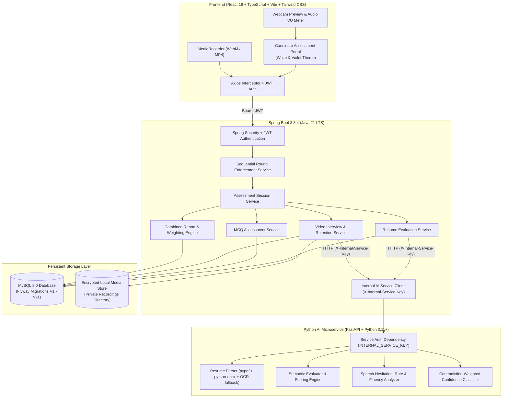
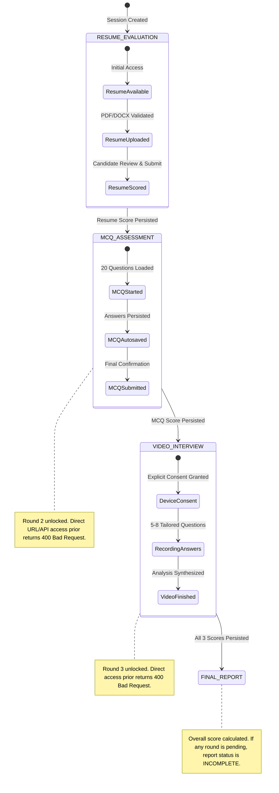
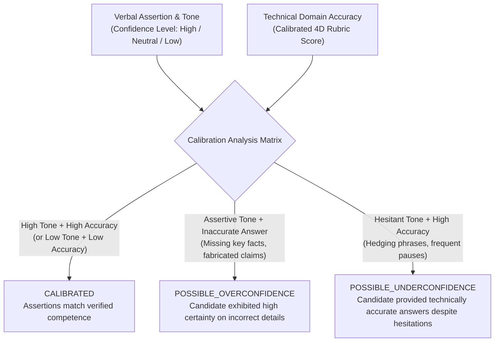

# InterviewVerse: Automated AI Technical Assessment & Multimodal Evaluation Platform

[](https://www.oracle.com/java/)
[](https://spring.io/projects/spring-boot)
[](https://react.dev/)
[](https://www.typescriptlang.org/)
[](https://www.python.org/)
[](https://fastapi.tiangolo.com/)
[](https://www.mysql.com/)
[](https://flywaydb.org/)
[](LICENSE)

InterviewVerse is an enterprise-grade technical assessment platform designed for engineering candidates and recruiters. It features a strict **3-Round Sequential Assessment Lifecycle** combining resume semantic matching, objective MCQ technical screening, and an AI-evaluated video interview with speech hesitation and contradiction-weighted confidence calibration, culminating in an authenticated, weighted final assessment scorecard.

---

## Table of Contents
1. [Core Features & Sequential Lifecycle](#1-core-features--sequential-lifecycle)
2. [System Architecture](#2-system-architecture)
3. [Design System](#3-design-system)
4. [Prerequisites & External Dependencies](#4-prerequisites--external-dependencies)
5. [Environment Variables & Configuration](#5-environment-variables--configuration)
6. [Sequential Assessment Workflow & Locking Rules](#6-sequential-assessment-workflow--locking-rules)
7. [Scoring Formulas & Configurable Weights](#7-scoring-formulas--configurable-weights)
8. [Contradiction-Weighted Confidence Calibration](#8-contradiction-weighted-confidence-calibration)
9. [Privacy, Data Retention & Candidate Self-Service Erasure](#9-privacy-data-retention--candidate-self-service-erasure)
10. [Security & Hardening](#10-security--hardening)
11. [Supported vs. Unavailable Metrics](#11-supported-vs-unavailable-metrics)
12. [API Reference](#12-api-reference)
13. [Step-by-Step Installation & Run Guide](#13-step-by-step-installation--run-guide)
14. [Automated Test Suite & Verification Results](#14-automated-test-suite--verification-results)
15. [Known Limitations & Roadmap](#15-known-limitations--roadmap)

---

## 1. Core Features & Sequential Lifecycle

InterviewVerse orchestrates an end-to-end evaluation journey structured across 3 distinct rounds:

1. **Round 1 — Resume Parser & Role-Based Evaluation**:
   - Accepts **PDF** and **DOCX** files with strict header and magic byte inspection.
   - Configurable 5 MB file size limit with rejection of empty, corrupt, or password-protected files.
   - Scanned PDF detection with OCR extraction notices.
   - Target roles supported: *Full Stack Developer, Software Developer, Java Developer, Frontend Developer, Backend Developer, Python Developer, Data Analyst, AI/ML Engineer*.
   - Never hallucinates missing data; flags unavailable sections transparently.
   - Candidate verification view allows candidates to inspect, correct, and confirm parsed details prior to scoring.
   - 4-pillar transparent match scoring: **Core Skills (40%), Experience & Seniority (25%), Project Relevance (25%), Education & Certifications (10%)**.

2. **Round 2 — MCQ Technical Assessment**:
   - Strictly unlocked only after Round 1 resume evaluation is saved.
   - Configurable 15 or 20 role-tailored questions (Easy, Medium, Hard difficulty tiers).
   - 4 options per question, exactly 1 correct answer.
   - Question navigation palette with *Answered*, *Unanswered*, and *Mark for Review* states.
   - Live autosave and recovery on browser refresh.
   - Scoring: $\text{Percentage} = (\text{Correct Answers} / \text{Total Questions}) \times 100$. No negative marking.
   - Post-submission topic breakdown and verified technical explanations.

3. **Round 3 — AI Video Interview & Speech Analytics**:
   - Strictly unlocked only after Round 2 MCQ is completed and persisted.
   - Explicit candidate consent gate disclosing transcript and speech analysis while confirming **zero biometric, facial emotion, eye contact, or body language tracking**.
   - Live webcam and microphone preview with dynamic audio-level VU metering.
   - Role-specific and resume-tailored interview questions synthesized by AI.
   - Browser recording via `MediaRecorder` API with chunk-based streaming and private upload.
   - Multidimensional evaluation: **Technical Accuracy (40%), Relevance (25%), Completeness (20%), Clarity (15%)**.
   - Speech hesitation analysis: filler word counts and rates, pauses, average pause duration, and speaking rate (WPM).
   - Contradiction-Weighted Confidence Calibration comparing asserted linguistic confidence against verified factual technical correctness.

4. **Final Combined Assessment Report**:
   - Strictly locked until all 3 rounds are successfully saved.
   - Overall score formula with configurable weights:
     $$\text{Overall Score} = (\text{Resume Score} \times 0.30) + (\text{MCQ Score} \times 0.30) + (\text{Video Score} \times 0.40)$$
   - Transparent scorecards for all 3 rounds, executive summary, synthesized strengths, identified skill gaps, and a 3-phase structured learning roadmap.
   - Strict multi-tenant candidate data isolation and candidate self-service recording purge.

---

## 2. System Architecture



---

## 3. Design System

The frontend adheres strictly to the modern **White & Violet** design system:

| Element | Hex Code | Usage |
| :--- | :--- | :--- |
| **Primary Violet** | `#7C3AED` | Primary buttons, active tabs, progress bars, key scorecards |
| **Dark Violet** | `#5B21B6` | Header banners, hover states, accent badges |
| **Light Violet** | `#EDE9FE` | Subtle card highlights, badge backgrounds, selected options |
| **Page Background** | `#FFFFFF` | Clean white primary canvas |
| **Secondary Background** | `#F5F3FF` | Contrast sections, sidebar panels, modal backdrops |
| **Neutral Dark** | `#1F2937` | Primary text and headings |
| **Neutral Subdued** | `#6B7280` | Secondary descriptions, timestamps, metadata |
| **Borders** | `#E5E7EB` | Dividers, card boundaries, input borders |

---

## 4. Prerequisites & External Dependencies

| Dependency | Minimum Version | Purpose |
| :--- | :--- | :--- |
| **Java JDK** | 21 LTS | Spring Boot backend compilation and execution |
| **Python** | 3.10, 3.11, or 3.12 | FastAPI AI Microservice runtime |
| **Node.js** | 20.x or higher | React + Vite frontend development & bundling |
| **MySQL Server** | 8.0 or higher | Relational database persistence |
| **FFmpeg** *(Optional)* | 4.4+ | Raw acoustic waveform prosody demuxing (if local extraction configured) |
| **Tesseract OCR** *(Optional)* | 5.0+ | Scanned PDF document optical character extraction fallback |

---

## 5. Environment Variables & Configuration

### Backend (`backend/src/main/resources/application.properties` or environment variables)

| Environment Variable | Default Value | Description |
| :--- | :--- | :--- |
| `SPRING_DATASOURCE_URL` | `jdbc:mysql://localhost:3306/interview_platform?createDatabaseIfNotExist=true` | MySQL JDBC Connection String |
| `SPRING_DATASOURCE_USERNAME` | `root` | MySQL Database Username |
| `SPRING_DATASOURCE_PASSWORD` | *(empty / your password)* | MySQL Database Password |
| `APP_JWT_SECRET` | *(64-char secure hex)* | HMAC-SHA256 signature key for candidate JWT tokens |
| `APP_AI_SERVICE_URL` | `http://localhost:8000` | Base URL of FastAPI AI microservice |
| `APP_INTERNAL_SERVICE_KEY` | *(shared secret)* | Shared secret sent in `X-Internal-Service-Key` header |
| `APP_VIDEO_STORAGE_DIR` | `interview_recordings` | Private directory for storing candidate video recordings |
| `APP_VIDEO_RETENTION_DAYS` | `30` | Automatic retention expiration horizon in days |
| `APP_ASSESSMENT_WEIGHT_RESUME` | `0.30` | Weight assigned to Round 1 Resume Evaluation (30%) |
| `APP_ASSESSMENT_WEIGHT_MCQ` | `0.30` | Weight assigned to Round 2 MCQ Assessment (30%) |
| `APP_ASSESSMENT_WEIGHT_VIDEO` | `0.40` | Weight assigned to Round 3 AI Video Interview (40%) |
| `APP_RESUME_MAX_FILE_SIZE` | `5242880` | Maximum resume upload size in bytes (5 MB) |

### AI Microservice (`ai-service/.env`)

| Environment Variable | Default Value | Description |
| :--- | :--- | :--- |
| `INTERNAL_SERVICE_KEY` | *(shared secret)* | Authenticates internal requests from Spring Boot backend |
| `WHISPER_MODEL` | `tiny` | Faster-Whisper local model size (`tiny`, `base`, `small`) |
| `TESSERACT_CMD` | `tesseract` | System binary path for fallback OCR extraction |

---

## 6. Sequential Assessment Workflow & Locking Rules

InterviewVerse enforces round prerequisites at both the **API layer** and the **UI layer**:



### Direct Bypass Protection
- Direct requests to `POST /api/v1/assessment-sessions/{id}/mcq/start` before resume scoring return `HTTP 400 Bad Request` with `"Complete Resume Evaluation to unlock this round."`
- Direct requests to `POST /api/v1/assessment-sessions/{id}/video/consent` before MCQ completion return `HTTP 400 Bad Request` with `"Complete MCQ Assessment to unlock this round."`
- Direct requests to `GET /api/v1/assessment-reports/session/{id}` before all 3 rounds are saved return `status: "INCOMPLETE"` with `overallScore: null` and a transparent explanation detailing pending rounds.
- Round weights are **never redistributed** to mask incomplete rounds.

---

## 7. Scoring Formulas & Configurable Weights

The overall assessment score is calculated strictly when all 3 valid, uncorrupted round scores are persisted:

$$\text{Overall Score} = (\text{Resume Score} \times W_{\text{resume}}) + (\text{MCQ Score} \times W_{\text{mcq}}) + (\text{Video Score} \times W_{\text{video}})$$

### Default Weights:
- **Resume Evaluation**: $30\%$ ($W_{\text{resume}} = 0.30$)
- **MCQ Technical Assessment**: $30\%$ ($W_{\text{mcq}} = 0.30$)
- **AI Video Interview**: $40\%$ ($W_{\text{video}} = 0.40$)

### Sub-Score Formulations:
1. **Resume Score ($0 - 100$)**:
   $$\text{Resume Score} = (S_{\text{skills}} \times 0.40) + (S_{\text{exp}} \times 0.25) + (S_{\text{proj}} \times 0.25) + (S_{\text{edu}} \times 0.10)$$
2. **MCQ Score ($0 - 100$)**:
   $$\text{MCQ Score} = \left(\frac{\text{Correct Answers}}{\text{Total Questions}}\right) \times 100$$
3. **Video Interview Score ($0 - 100$)**:
   $$\text{Question Score} = (\text{Accuracy} \times 0.40) + (\text{Relevance} \times 0.25) + (\text{Completeness} \times 0.20) + (\text{Clarity} \times 0.15)$$
   $$\text{Video Score} = \frac{1}{N} \sum_{i=1}^{N} \text{Question Score}_i$$

---

## 8. Contradiction-Weighted Confidence Calibration

InterviewVerse implements an ethical, explainable confidence calibration model that cross-references **linguistic assertiveness** against **factual technical accuracy**:



### Candidate Disclosures:
- Clearly indicates that pauses, fillers, and hesitation can be caused by cognitive processing, speech patterns, or neurodiversity, and **do not penalize technical accuracy**.
- Provides actionable recommendations on balancing pacing and verbal confidence.

---

## 9. Privacy, Data Retention & Candidate Self-Service Erasure

### Retention Horizon
- Video and audio recordings are stored in a private directory outside the public web root (`interview_recordings/`).
- Stored recordings automatically expire after **30 days** (`recordings_retention_expires_at`).

### Candidate Self-Service Purge
Candidates maintain complete data sovereignty over their biometric media:
- Candidates can purge their video recordings on-demand at any time directly from the Final Report page.
- Calling `DELETE /api/v1/assessment-sessions/{sessionId}/video/recordings`:
  - Permanently deletes all recording files (`.webm`, `.mp4`) from disk.
  - Updates `AssessmentSession` with `recordings_deleted_at = NOW()` and `recordings_deleted_by_user = true`.
  - Clears `recording_url` and records `recording_deleted_at` on each `VideoInterviewQuestion`.
  - Preserves qualitative transcripts, analytical metrics, and scorecards for interview verification.
  - Subsequent streaming requests to `GET .../stream` immediately return `HTTP 404 Not Found`.

### Multi-Tenant Isolation
- Candidates can **only** access and delete their own sessions and recordings. Unauthorized attempts by another user return `HTTP 403 Forbidden`.

---

## 10. Security & Hardening

1. **Service-to-Service Authentication**:
   - The Python AI microservice enforces an `INTERNAL_SERVICE_KEY` security dependency.
   - Any external or direct unauthenticated request to `/internal/*` routes is rejected with `HTTP 401 Unauthorized`.
   - The Spring Boot backend securely injects `X-Internal-Service-Key` into all microservice calls.

2. **Binary Container & Magic Bytes Inspection**:
   - File uploads inspect leading magic bytes to ensure real file integrity:
     - **WebM / MKV**: `\x1A\x45\xDF\xA3`
     - **MP4**: `ftyp` box marker
     - **PDF**: `%PDF-` header
     - **DOCX**: `PK\x03\x04` ZIP archive header
   - Fake or renamed executable files are rejected with `HTTP 400 Bad Request`.

3. **Storage Outside Web Root**:
   - Recordings are never placed under static resource paths. Video streams are served exclusively through an authenticated Spring Boot streaming endpoint verifying candidate ownership.

4. **Flyway Database Migration Versioning**:
   - 11 formal migrations manage schema integrity seamlessly:
     - `V1`–`V3`: Initial users, question banks, answers, and evaluations.
     - `V4`–`V6`: Assessment sessions, resume evaluations, and candidate review data.
     - `V7`–`V9`: Video interview questions, analytics metrics, and speech fluency.
     - `V10`: Combined assessment reports and multi-round scorecards.
     - `V11`: Data retention expiration timestamps and candidate self-service erasure audit fields.

---

## 11. Supported vs. Unavailable Metrics

InterviewVerse prioritizes technical integrity over fabricated estimations:

| Metric | Status | Implementation Details |
| :--- | :--- | :--- |
| **Transcription** | **Supported** | Local Faster-Whisper with word-level timestamps; fallbacks clearly explained |
| **Speech Hesitation** | **Supported** | Filler word counts & rates (um, uh, like, you know), pauses, and pause duration |
| **Speaking Rate** | **Supported** | Words-per-minute (WPM) classified into Deliberate, Normal, or Fast-Paced |
| **Sentiment** | **Supported** | Linguistic vocabulary and confidence analysis from speech transcripts |
| **Confidence Calibration** | **Supported** | Contradiction-weighted matrix comparing assertiveness with technical correctness |
| **Acoustic Prosody** | **Unavailable (Documented)** | Compressed WebM/MP4 containers require external FFmpeg demuxing for raw acoustic waveforms; clearly marked `UNAVAILABLE` with candidate explanation |
| **Facial Emotion / Eye Contact** | **Explicitly Excluded** | Disclosed upfront to candidate; excluded to eliminate bias |

---

## 12. API Reference

### Authentication & Profiles
| Method | Endpoint | Description |
| :--- | :--- | :--- |
| `POST` | `/api/v1/auth/register` | Register new candidate account |
| `POST` | `/api/v1/auth/login` | Authenticate candidate & obtain JWT |
| `GET` | `/api/v1/auth/me` | Fetch authenticated candidate profile |

### Assessment Sessions & Sequential Flow
| Method | Endpoint | Description |
| :--- | :--- | :--- |
| `POST` | `/api/v1/assessment-sessions` | Create assessment session (starts in Round 1) |
| `GET` | `/api/v1/assessment-sessions/active` | Get or restore currently active session |
| `GET` | `/api/v1/assessment-sessions/{id}` | Get session details & sequential round status |

### Round 1: Resume Evaluation
| Method | Endpoint | Description |
| :--- | :--- | :--- |
| `POST` | `/api/v1/assessment-sessions/{id}/resume/upload` | Upload & parse resume file (PDF/DOCX) |
| `POST` | `/api/v1/assessment-sessions/{id}/resume/evaluate` | Review, correct & score resume (unlocks Round 2) |
| `GET` | `/api/v1/assessment-sessions/{id}/resume` | Get saved resume evaluation scorecard |

### Round 2: MCQ Technical Assessment
| Method | Endpoint | Description |
| :--- | :--- | :--- |
| `POST` | `/api/v1/assessment-sessions/{id}/mcq/start` | Start MCQ assessment (requires Round 1 completed) |
| `GET` | `/api/v1/interviews/{interviewId}/questions` | Fetch MCQ questions for session |
| `POST` | `/api/v1/interviews/{interviewId}/answers` | Autosave question answer |
| `POST` | `/api/v1/assessment-sessions/{id}/mcq/complete` | Submit & score MCQ round (unlocks Round 3) |

### Round 3: AI Video Interview
| Method | Endpoint | Description |
| :--- | :--- | :--- |
| `POST` | `/api/v1/assessment-sessions/{id}/video/consent` | Submit candidate consent & generate questions |
| `POST` | `/api/v1/assessment-sessions/{id}/video/questions/{qId}/upload` | Upload recorded answer video & run speech analytics |
| `GET` | `/api/v1/assessment-sessions/{id}/video/questions/{qId}/stream` | Authenticated private video playback stream |
| `POST` | `/api/v1/assessment-sessions/{id}/video/finish` | Finalize video interview round & calibrate confidence |
| `DELETE` | `/api/v1/assessment-sessions/{id}/video/recordings` | Candidate on-demand recording purge |

### Final Combined Report
| Method | Endpoint | Description |
| :--- | :--- | :--- |
| `GET` | `/api/v1/assessment-reports/session/{sessionId}` | Get or generate final report (requires all 3 rounds) |
| `GET` | `/api/v1/assessment-reports/{reportId}` | Retrieve saved final report by ID |
| `GET` | `/api/v1/assessment-reports/user/history` | List historical assessment reports for candidate |

---

## 13. Step-by-Step Installation & Run Guide

### 1. Database Setup
```bash
# Ensure MySQL is running on port 3306
mysql -u root -p
CREATE DATABASE interview_platform;
```

### 2. AI Microservice Setup (FastAPI)
```powershell
cd ai-service
python -m venv venv
.\venv\Scripts\activate
pip install -r requirements.txt

# Start FastAPI microservice (Port 8000)
python -m uvicorn app.main:app --host 0.0.0.0 --port 8000
```

### 3. Backend Setup (Spring Boot)
```powershell
cd backend
mvn clean package -DskipTests

# Start Spring Boot backend (Port 8080)
java -jar target/platform-backend-1.0.0.jar
```

### 4. Frontend Setup (React + Vite)
```powershell
cd frontend
npm install
npm run dev
# Accessible at http://localhost:5173
```

---

## 14. Automated Test Suite & Verification Results

All automated test suites pass with **100% success**:

### 1. Spring Boot Backend Tests (51/51 Passed)
```powershell
cd backend
mvn test
```
- `AssessmentReportServiceTest`: 6 tests passed (weighting formulas, duplicate prevention, ownership security)
- `AssessmentSessionServiceTest`: 11 tests passed (sequential round locking, state restoration)
- `AuthServiceTest`: 3 tests passed (JWT generation, password hashing)
- `ResumeEvaluationServiceTest`: 9 tests passed (file validation, role normalization, scoring)
- `VideoInterviewServiceTest`: 13 tests passed (magic bytes rejection, candidate media deletion, private streaming)
- `InterviewServiceTest`: 7 tests passed (MCQ navigation, autosave, scoring)
- `CandidateProfileTest`: 2 tests passed

### 2. FastAPI Microservice Tests (12/12 Passed)
```powershell
cd ai-service
pytest
```
- Verified `test_internal_endpoint_rejects_unauthorized` returns `HTTP 401` when `X-Internal-Service-Key` is missing.
- Verified resume extraction, scanned PDF detection, and semantic answer rubrics.

### 3. Frontend Production Build (0 Errors)
```powershell
cd frontend
npm run build
```
- Full TypeScript type-checking and production bundle compilation completed cleanly.

### 4. End-to-End Full Flow Integration Verification (15/15 Passed)
```powershell
python test_full_system_integration.py
```
- Confirmed full flow: Registration $\rightarrow$ Resume Upload $\rightarrow$ Verification & Scoring $\rightarrow$ Sequential Unlocking $\rightarrow$ MCQ Completion $\rightarrow$ Video Recording & Analytics $\rightarrow$ Final Combined Scorecard $\rightarrow$ Multi-Tenant Security $\rightarrow$ Candidate Recording Purge.

---

## 15. Known Limitations & Roadmap

1. **Acoustic Container Demuxing**:
   - Prosody and acoustic waveform pitch/energy measurements on browser WebM/Opus recordings require system-level FFmpeg installed on the host. When unavailable, speech analysis gracefully falls back to transcript lexical pacing with clear candidate disclosures.
2. **Audio/Video Chunks Streaming**:
   - Recordings are currently uploaded on per-question completion. Future releases will support real-time WebSocket audio streaming for live transcription.
3. **Multi-Language Support**:
   - Current question banks and NLP rubrics are optimized for English technical assessments. Internationalization is planned for subsequent iterations.

---

*InterviewVerse is developed for educational and skill assessment purposes.*
